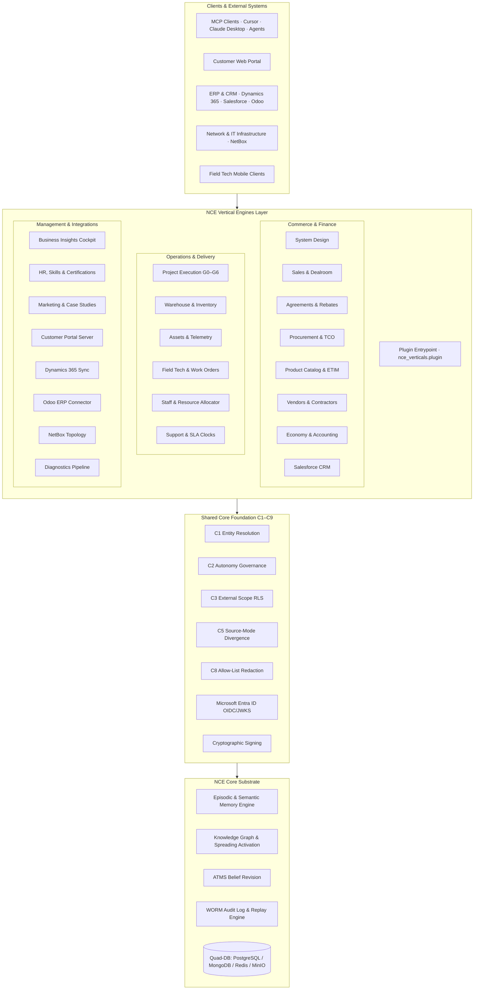

# NCE Vertical Engines

> 22 operational business engines, enterprise IT/ERP integrations, and domain modules built on the Neuro-Cognitive Engine (NCE) substrate.

<p>
  
  
  
  
</p>

`nce-vertical-engines` is the official domain extension suite for the **Neuro-Cognitive Engine (NCE)**. While NCE Core provides the cognitive memory and reasoning foundation—spanning episodic-to-semantic consolidation, Ebbinghaus salience decay, ATMS truth maintenance, WORM audit trails, and multi-tenant Row-Level Security—`nce-vertical-engines` turns that substrate into a comprehensive, autonomous enterprise operating system.

---

## Table of Contents

- [Architecture & System Flow](#architecture--system-flow)
- [The 22-Engine Catalog](#the-22-engine-catalog)
- [Dual-Axis Classification & Filters](#dual-axis-classification--filters)
  - [Axis 1 — Type Filter (`types`)](#axis-1--type-filter-types)
  - [Axis 2 — Business Category Filter (`categories`)](#axis-2--business-category-filter-categories)
- [5 Installation & Runtime Activation Modes](#5-installation--runtime-activation-modes)
- [CLI Reference & Packaged Server Entrypoints](#cli-reference--packaged-server-entrypoints)
- [Security & Workplace Telemetry Governance](#security--workplace-telemetry-governance)
- [Shared-Core Foundation (C1–C9)](#shared-core-foundation-c1c9)
- [Docker Compose Stack](#docker-compose-stack)
- [Terminology: "kickback" (Volume Rebate)](#terminology-kickback)
- [Testing & Quality Assurance](#testing--quality-assurance)
- [Documentation Index](#documentation-index)
- [License & Attribution](#license--attribution)

---

## Architecture & System Flow

The vertical engines interact with clients and backing services through standard Model Context Protocol (MCP) tool registrations, Starlette/FastAPI REST route mounts, and asynchronous outbox workers:



---

## The 22-Engine Catalog

Each engine provides domain-specific data models, confirm-first autonomy boundaries, MCP tools, and REST handlers:

| # | Engine | Slug | Type Filter(s) | Business Category Filter(s) | Optional SDK Extras | SQL Schema Prerequisites (`requires_schemas`) |
|:---|:---|:---|:---|:---|:---|:---|
| 1 | **Product Catalog** | `product` | `core-domain` | `commercial`, `av-it-integrator` | `product` | `009_product_catalog_schema`, `011_product_match_feedback`, `012_product_enrichment_log`, `038_product_catalog_global`, `071_product_lifecycle_status_check`, `074_product_catalog_successor` |
| 2 | **Procurement & TCO** | `procurement` | `core-domain` | `commercial`, `operations-delivery` | `procurement` | `013_procurement_bid_prices`, `014_procurement_source_id`, `047_procurement_po_lines`, `065_procurement_deal_registrations` |
| 3 | **Agreements & Rebates** | `agreements` | `core-domain` | `commercial`, `finance-governance` | `agreements` | `022_agreement_review`, `023_agreements_source_id`, `061_agreement_parties_and_resources` |
| 4 | **Vendors & Contractors** | `vendors` | `core-domain` | `commercial`, `operations-delivery` | `vendors` | `019_vendors_source_id`, `020_vendor_scorecards`, `021_contractor_profiles` |
| 5 | **Sales & Dealroom** | `sales` | `core-domain` | `commercial` | `sales` | `017_sales_read_model`, `018_sales_signed_baselines`, `032_sales_signed_baselines_bigserial`, `055_sales_resource_tables`, `062_sales_contacts`, `064_sales_quote_billing_method`, `066_quote_templates_and_packages`, `072_sales_deal_participants` |
| 6 | **System Design & FL** | `system_design` | `core-domain`, `infra-iot` | `commercial`, `av-it-integrator` | `system_design` | `015_system_design_source_id`, `016_system_design_device_capabilities`, `034_bom_line_content`, `035_system_design_geometry`, `036_system_design_node_state`, `037_bom_line_priced`, `049_system_design_sidetable_fk_cascade`, `069_system_design_design_requests` |
| 7 | **Project Execution** | `project` | `core-domain` | `operations-delivery` | `project` | `018_sales_signed_baselines`, `048_decision_feedback` |
| 8 | **Economy & Accounting** | `economy` | `core-domain` | `finance-governance`, `commercial` | `economy` | `024_economy_bom_actual_cost`, `025_economy_postings`, `026_economy_contracts`, `059_pricing_fx_rates`, `067_billing_runs`, `068_billing_candidates`, `070_customer_invoices` |
| 9 | **Warehouse & Inventory** | `inventory` | `core-domain` | `operations-delivery`, `av-it-integrator` | `inventory` | `027_inventory_core`, `028_inventory_transactions`, `029_goods_receipts`, `030_inventory_rma` |
| 10 | **Asset Lifecycle & Telemetry**| `assets` | `core-domain`, `infra-iot` | `operations-delivery`, `service-support`, `av-it-integrator` | `assets` | `031_assets`, `033_telemetry_samples`, `054_assets_shell_product` |
| 11 | **Support & SLA Clocks** | `support` | `core-domain` | `service-support` | `support` | `039_support_service_tickets`, `058_support_ticket_actions`, `073_support_ticket_actions_append_only` |
| 12 | **Staff & Capacity Allocator** | `resources` | `core-domain` | `operations-delivery`, `field-service-ops` | `resources` | `043_resources_registry`, `044_allocations_btree_gist` |
| 13 | **Field Tech Work Orders** | `field_tech` | `core-domain` | `operations-delivery`, `field-service-ops` | `field_tech` | `040_field_tech_work_orders` |
| 14 | **HR & Skills Matrix** | `hr` | `core-domain` | `operations-delivery`, `finance-governance` | `hr` | `041_hr_engine` |
| 15 | **Marketing & Case Studies** | `marketing` | `core-domain` | `commercial` | `marketing` | `042_marketing_engine` |
| 16 | **Business Insights** | `business_insights` | `observability`, `core-domain` | `commercial`, `finance-governance` | `business_insights` | `045_business_insights_engine` |
| 17 | **Customer Portal** | `customer_portal` | `portal` | `service-support`, `commercial` | `portal` | `046_customer_portal_engine` |
| 18 | **NetBox DCIM / IPAM** | `netbox` | `infra-iot`, `observability` | `av-it-integrator`, `operations-delivery` | `netbox` | `001_d365_integrations_and_mappings` *(shared `d365_netbox_mappings` table bundled in base wheel; no `dynamics365` SDK required)* |
| 19 | **Dynamics 365 Sync** | `dynamics365` | `erp-crm` | `enterprise-erp`, `commercial`, `service-support` | `dynamics365` | `001_d365_integrations_and_mappings`, `002_d365_sync_runs`, `003_d365_change_tracking` |
| 20 | **Diagnostics Profiler** | `diagnostics` | `observability`, `infra-iot` | `service-support`, `av-it-integrator` | `diagnostics` | `004_diagnostics` |
| 21 | **Odoo ERP Connector** | `odoo` | `erp-crm` | `enterprise-erp`, `commercial`, `finance-governance` | `odoo`, `entra_id` | `075_entra_id_security_gate`, `081_odoo_vertical_engine` |
| 22 | **Salesforce CRM** | `salesforce` | `erp-crm` | `commercial`, `enterprise-erp` | `salesforce`, `entra_id` | `075_entra_id_security_gate`, `076_salesforce_vertical_engine` |

> [!NOTE]
> **Installable Vertical Engines vs. Shared-Core Support Packages:**
> The **22 installable vertical engines** listed above are dynamically controlled, filtered, and activated via `NCE_ENABLED_ENGINES`, `NCE_ENGINE_TYPE_FILTER`, and `NCE_ENGINE_CATEGORY_FILTER`. In contrast, the **shared-core support packages** (`documents`, `geodata`, `legal_entities`, `notifications`, `sites`, `shared`, `security`, `servers`) represent foundational shared infrastructure and are bundled automatically inside the `nce_verticals` distribution wheel, providing universal cross-engine capabilities (such as entity resolution, C3 external-scope confinement, document attachment registries, and Brønnøysundregistrene/Kartverket geocoding) across all deployments regardless of which vertical engines are active.

---

## Dual-Axis Classification & Filters

The Dual-Axis Architecture allows modular deployments to be sliced across two orthogonal axes:

### Axis 1 — Type Filter (`types`)

Filters engines based on execution runtime, connectivity mode, and architecture:

| Type Slug | Type Name | Scope & Technical Profile | Member Engines |
|:---|:---|:---|:---|
| `core-domain` | Core Domain Services | Core transactional and computational business engines that operate directly against NCE's Quad-DB substrate and knowledge graph. | `product`, `procurement`, `agreements`, `vendors`, `sales`, `system_design`, `project`, `economy`, `inventory`, `assets`, `support`, `resources`, `field_tech`, `hr`, `marketing`, `business_insights` |
| `erp-crm` | ERP & CRM Connectors | Bidirectional enterprise sync engines connecting external systems-of-record into NCE graph and change-tracking ledgers. | `dynamics365`, `salesforce`, `odoo` |
| `infra-iot` | Infrastructure & IoT | Network topology, hardware discovery, sensors, and physical equipment controllers. | `netbox`, `assets`, `system_design`, `diagnostics` |
| `observability` | Observability & Diagnostics | Telemetry digestion, log anomaly detection, cross-engine risk radar, and executive analytics. | `diagnostics`, `business_insights`, `netbox` |
| `portal` | Customer & Partner Portals | Dedicated external-facing unprivileged ASGI application shells executing under strict C3 principal confinement. | `customer_portal` |

### Axis 2 — Business Category Filter (`categories`)

Filters engines based on organizational departments, operational workflows, and business domains:

| Category Slug | Category Name | Scope & Operational Discipline | Member Engines |
|:---|:---|:---|:---|
| `commercial` | Commercial & Commerce | Sales dealrooms, CPQ pricing baselines, customer quote freeze, distributor feeds, agreements, and CRM integrations. | `product`, `procurement`, `agreements`, `vendors`, `sales`, `system_design`, `economy`, `marketing`, `business_insights`, `customer_portal`, `dynamics365`, `salesforce`, `odoo` |
| `operations-delivery` | Operations & Delivery | Stage-gate project execution (G0–G6), multi-warehouse inventory algebra, resource capacity, and ISO competency matrices. | `procurement`, `vendors`, `project`, `inventory`, `assets`, `resources`, `field_tech`, `hr`, `netbox` |
| `finance-governance` | Finance & Governance | NGAAP accounting cascades, PEPPOL e-invoicing, volume rebates (kickbacks), balance verification triggers, and contract audits. | `agreements`, `economy`, `hr`, `business_insights`, `odoo` |
| `service-support` | Service & Support | Multi-tier ticketing, automated SLA countdown clocks, on-call rotation, hardware health profiling, and customer self-service. | `assets`, `support`, `customer_portal`, `diagnostics`, `dynamics365` |
| `av-it-integrator` | AV/IT Integrator Specialist | Specialized AV/IT topology design, Functional Location trees, NetBox DCIM sync, and distributor BOM matching. | `product`, `system_design`, `inventory`, `assets`, `netbox`, `diagnostics` |
| `enterprise-erp` | Enterprise ERP & CRM | Large-scale external enterprise platforms managing master accounts, contacts, field services, and ledger sync. | `dynamics365`, `salesforce`, `odoo` |
| `field-service-ops` | Field Service Operations | Mobile work orders, offline synchronization, technician checklists, and site logistics. | `resources`, `field_tech` |

---

## 5 Installation & Runtime Activation Modes

> **Substrate Requirement:** Requires Core `neuro-cognitive-engine>=3.4.3,<4.0.0`. For enterprise identity and token verification, install with the `entra_id` extra: `pip install "nce-vertical-engines[entra_id]"`.

Deployments can activate vertical engines through 5 flexible modes:

### Mode 1: Single Engine
Install and activate a single engine (e.g. Odoo):
```bash
pip install "nce-vertical-engines[odoo]"
export NCE_ENABLED_ENGINES=odoo
```

### Mode 2: By Type Filter
Install and activate all engines matching a technical system type (e.g. ERP/CRM connectors):
```bash
pip install "nce-vertical-engines[type-erp-crm]"
export NCE_ENGINE_TYPE_FILTER=erp-crm
```

### Mode 3: By Business Category Filter
Install and activate all engines supporting a business division (e.g. Commercial & Commerce):
```bash
pip install "nce-vertical-engines[cat-commercial]"
export NCE_ENGINE_CATEGORY_FILTER=commercial
```

### Mode 4: Combined Type + Category Intersection
Activate the strict intersection of a type and a category (e.g. AV/IT Infrastructure & IoT):
```bash
# Option A: using independent environment variables
export NCE_ENGINE_TYPE_FILTER=infra-iot
export NCE_ENGINE_CATEGORY_FILTER=av-it-integrator

# Option B: using compound syntax in NCE_ENABLED_ENGINES
export NCE_ENABLED_ENGINES="type:infra-iot+category:av-it-integrator"
```

### Mode 5: All 22 Engines (Full Suite)
Install and activate the entire 22-engine suite:
```bash
pip install "nce-vertical-engines[all]"
export NCE_ENABLED_ENGINES=all
```

---

## CLI Reference & Packaged Server Entrypoints

### CLI Reference

`nce-vertical-engines` provides a unified CLI tool for inspecting and managing vertical engines:

```bash
# List all 22 available engines
nce-verticals list

# Filter engines by technical system type
nce-verticals list --type erp-crm

# Filter engines by business category
nce-verticals list --category av-it-integrator

# Combined type and category query
nce-verticals list --type infra-iot --category av-it-integrator

# Show only locally installed engines with met SDK dependencies
nce-verticals list --installed-only

# Emit machine-readable JSON catalog
nce-verticals list --type core-domain --json
```

### Packaged Standalone Server Entrypoints

Dedicated ASGI server entrypoints are packaged directly in `[project.scripts]` for micro-deployments:

| Command | Module | Default Port | Description |
|:---|:---|:---|:---|
| `nce-portal-server` | `nce_verticals.servers.portal:app` | `8010` | Customer-facing self-service portal running under unprivileged C3 principal confinement. |
| `nce-odoo-server` | `nce_verticals.servers.odoo:app` | `8011` | Odoo XML-RPC/JSON-RPC integration and cross-engine LLM crosstalk server gated by Microsoft Entra ID. |
| `nce-salesforce-server` | `nce_verticals.servers.salesforce:app` | `8012` | Salesforce CRM and Bulk API 2.0 integration server gated by Microsoft Entra ID. |

To run any standalone server directly:
```bash
uvicorn nce_verticals.servers.portal:app --host 0.0.0.0 --port 8010
uvicorn nce_verticals.servers.odoo:app --host 0.0.0.0 --port 8011
uvicorn nce_verticals.servers.salesforce:app --host 0.0.0.0 --port 8012
```

---

## Security & Workplace Telemetry Governance

### Microsoft Entra ID OIDC / JWKS (`nce_verticals.security.entra_id`)
Enterprise authentication across standalone servers and admin endpoints is governed by Microsoft Entra ID (Azure AD):
- **Cryptographic JWT Validation**: Keys retrieved from `https://login.microsoftonline.com/{tenant_id}/discovery/v2.0/keys` with bounded TTL caching.
- **Allowed Algorithms**: Strictly limited to `RS256` and `ES256`.
- **Claim Checking**: Validates `iss`, `aud`, `exp`, `nbf`, `tid`, and `oid`.
- **Security Groups & App Roles**: Verifies Microsoft Graph group object IDs and Enterprise Application App Roles before granting administrative access.
- **Migration `075` Security Gate**: Schema gate `075_entra_id_security_gate.sql` validates tenant identity bindings, app role claims, and cryptographic JWKS signatures before mounting Odoo, Salesforce, and Entra-protected routes.

### HTTP Ingress & Egress Guards (`nce_verticals.security.http_guard`)
Enterprise communication paths are protected by strict boundary guards:
- **`BoundedBodyMiddleware` (HTTP 413):** All standalone ASGI servers (`nce-portal-server`, `nce-odoo-server`, `nce-salesforce-server`) enforce `BoundedBodyMiddleware` (`NCE_MAX_HTTP_BODY_BYTES`, default 10 MiB), rejecting oversized payloads with HTTP `413 Payload Too Large`.
- **SSRF Egress Guard (`validate_outbound_url`):** External outbound requests across Odoo, Salesforce, NetBox, and geodata adapters are validated to block private subnets, loopback, Carrier-Grade NAT (`100.64.0.0/10`), and IPv4-mapped IPv6 metadata traversal (`::ffff:169.254.169.254`).

### Odoo XML-RPC Hardening (`defusedxml.xmlrpc`)
The Odoo connector wraps XML-RPC communication via `defusedxml.xmlrpc`:
- **Billion Laughs & DTD Entity Protection:** Rejects XML entity expansion, recursive entity nesting, and quadratic blowup payloads.
- **XXE Prevention:** Completely disables external entity parsing and file disclosure vulnerabilities during remote XML-RPC interactions.

### Workplace Telemetry Opt-In Gate (`NCE_ENABLE_WORKPLACE_TELEMETRY=false`)
In adherence to privacy regulations and labor laws (e.g. GDPR, *Arbeidsmiljøloven* § 13), **longitudinal operator stress tracking is strictly disabled by default**:

```env
# Default: workplace telemetry is OFF
NCE_ENABLE_WORKPLACE_TELEMETRY=false
```

When disabled (`false`):
1. **NetBox Contacts**: `fetch_stress_records_for_operator` returns `[]` immediately without querying `v3_cognitive_ledger`. `evaluate_contact_stress_report` returns `{"status": "telemetry_disabled", "telemetry_enabled": False}`. `sync_contacts_and_update_oncall` keeps all operators at weight `1.0` and status `active`.
2. **Dynamics 365 Ingestion**: `_compute_empathic_tensor` yields a neutral baseline `[5.0, 0.0, 5.0, 0.0, 0.0, 0.0]`. `_insert_cognitive_ledger` is a no-op, skipping insertion into `v3_cognitive_ledger`.
3. **Dynamics 365 MCP Handlers**: `handle_d365_case_stress_report` immediately returns status `telemetry_disabled` with `telemetry_enabled: False` without querying the database.

Set `NCE_ENABLE_WORKPLACE_TELEMETRY=true` only with explicit organizational opt-in.

---

## Shared-Core Foundation (C1–C9)

All 22 vertical engines build upon NCE's enterprise governance framework:

- **C1: Entity Resolution** — Cross-source entity deduplication, survivorship rules, and merge-review queues preventing duplicate accounts and devices.
- **C2: Autonomy Governance** — Enforces `@governed` confirm-first gates, value/volume thresholds, and an instantaneous kill-switch for automated operations.
- **C3: External Scope RLS** — Database-level tenant and partner confinement ensuring subcontractors and customers see only authorized rows.
- **C5: Source-Mode Divergence** — Per-field resolution (`d365 | both | nce`) with automated divergence detection and reconciliation queues.
- **C8: Allow-List Redactor** — Strict allow-list sanitization of outbound payloads, preventing accidental data exfiltration across boundaries.
- **Cryptographic Signing** — SHA-256 HMAC and asymmetric signing ceremony for quotes, purchase orders, and legal documents leaving the system.

---

## Docker Compose Stack

The standalone engines and customer portal can be deployed alongside NCE Core via Docker Compose:

```bash
# Launch portal and standalone servers
docker compose -f docker-compose.yml -f docker-compose.verticals.yml up -d portal odoo salesforce
```

Environment variables passed to the services:
- `NCE_ENABLED_ENGINES=${NCE_ENABLED_ENGINES:-all}`
- `NCE_ENGINE_TYPE_FILTER=${NCE_ENGINE_TYPE_FILTER:-}`
- `NCE_ENGINE_CATEGORY_FILTER=${NCE_ENGINE_CATEGORY_FILTER:-}`
- `NCE_ENABLE_WORKPLACE_TELEMETRY=${NCE_ENABLE_WORKPLACE_TELEMETRY:-false}`

---

## Terminology: "kickback"

This codebase uses the word **kickback** exclusively in its standard Norwegian commercial sense (*volumbasert leverandørrabatt*), where *kickback* refers to an ordinary **volume-based supplier rebate**—a negotiated commercial discount that a vendor pays back to a buyer once agreed purchasing thresholds are achieved.

> [!NOTE]
> In Nordic commercial law, contract drafting, and accounting records (NGAAP), volume rebates are openly negotiated clauses in framework agreements. **The term does NOT denote a bribe, secret commission, or unlawful inducement.**

The codebase rigorously enforces this distinction:
1. **Semantic Separation in Compliance Scanning**: In the agreement compliance analyzer (`compliance.py`), `kickback_prohibited` (rebate prohibition) and `anti_bribery` (anti-corruption clause) are **distinct, independent evaluation rules**.
2. **Third-Party Contract Text Matching**: Search patterns such as `no_kickback` and `kickback_prohibited` are maintained to accurately inspect external vendor contracts using Norwegian business phrasing.
3. **Internal Ranking Safety**: Internal supplier-scoring metrics avoid ambiguous phrasing; supplier scoring relies on `rebate_proximity` rather than informal terminology.

---

## Testing & Quality Assurance

The vertical engines include a comprehensive test suite (unit tests, contract verification, and live integration tests) verifying RLS boundary enforcement, idempotency, and state transitions:

```bash
# Run unit and contract test suite
make test

# Run code style and linting checks
make lint

# Run strict static type checking
make typecheck
```

Or invoke pytest directly:

```bash
pytest tests/
pytest tests/integration/ -m integration
```

---

## Documentation Index

Comprehensive guides, specifications, and reference materials are maintained in the [`docs/`](docs/) directory:

- **Dual-Axis Architecture**: [`docs/DUAL_AXIS_ARCHITECTURE.md`](docs/DUAL_AXIS_ARCHITECTURE.md) — Comprehensive spec on the Dual-Axis Resolver, topological schema graph, and Core `@v3.4.3` contracts.
- **Engine Specifications**: [`docs/vertical_engines/`](docs/vertical_engines/) — In-depth architectural specs for all engines.
- **User & Admin Guides**: [`docs/engines/`](docs/engines/) — Operational guides for end users and system administrators.
- **Integration References**:
  - [Dynamics 365 Integration Reference](docs/d365_integration_reference.md)
  - [NetBox & Cognitive Extensions](docs/netbox_and_cognitive_extensions.md)

---

## License & Attribution

Licensed under the **GNU Affero General Public License, Version 3 (AGPL-3.0)**. See [`LICENSE`](LICENSE) and [`NOTICE`](NOTICE) for details.

Copyright © 2026 Sindre Løvlie Haugen. All rights reserved.
