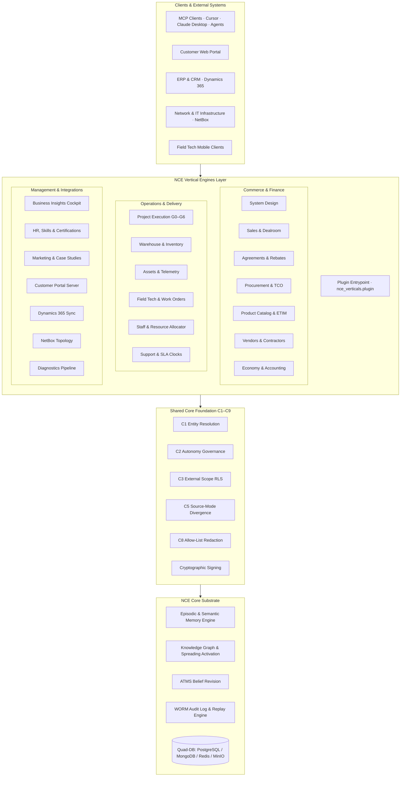

# NCE Vertical Engines

> 20 operational business engines, enterprise IT/ERP integrations, and domain modules built on the Neuro-Cognitive Engine (NCE) substrate.

<p>
  
  
  
  
</p>

`nce-vertical-engines` is the official domain extension suite for the **Neuro-Cognitive Engine (NCE)**. While NCE Core provides the cognitive memory and reasoning foundation—spanning episodic-to-semantic consolidation, Ebbinghaus salience decay, ATMS truth maintenance, WORM audit trails, and multi-tenant Row-Level Security—`nce-vertical-engines` turns that substrate into a comprehensive, autonomous enterprise operating system.

---

## Table of Contents

- [Architecture & System Flow](#architecture--system-flow)
- [The 20 Vertical Engines](#the-20-vertical-engines)
- [Shared-Core Foundation (C1–C9)](#shared-core-foundation-c1c9)
- [Installation & Setup](#installation--setup)
- [Configuration & Per-Engine Opt-In](#configuration--per-engine-opt-in)
- [Terminology: "kickback" (Volume Rebate)](#terminology-kickback)
- [Testing & Quality Assurance](#testing--quality-assurance)
- [Documentation Index](#documentation-index)
- [License & Attribution](#license--attribution)

---

## Architecture & System Flow

The vertical engines interact with clients and backing services through standard Model Context Protocol (MCP) tool registrations, Starlette/FastAPI REST route mounts, and asynchronous outbox workers:



---

## The 20 Vertical Engines

Each engine provides domain-specific data models, business rules, confirm-first autonomy boundaries, MCP tools, and REST handlers:

| # | Engine | Module Slug | Key Capabilities & Responsibility |
|:---|:---|:---|:---|
| 1 | **Product** | `product` | Catalog search, on-demand distributor ingestion, ETIM parameter mapping, golden-record survivorship, BOM cross-references, EOL watchers. |
| 2 | **Procurement** | `procurement` | Supplier ranking, TCO calculation, 3-way invoice/PO/GR matching, autonomous purchase order issuance behind strict confirm-first ceilings. |
| 3 | **Agreements** | `agreements` | Document OCR extraction, human legal review queue, SLA commitments, volume rebate (kickback) reconciliation, room category price schedules. |
| 4 | **Vendors** | `vendors` | Vendor registry with multidimensional scorecards, subcontracting capacity, contractor certifications, partner-scoped data isolation. |
| 5 | **Sales** | `sales` | Lead-to-quote lifecycle, pricing resolution, DealRoom collaboration, immutable signed-baseline quote freeze, HMAC-tokenized public quotes. |
| 6 | **System Design** | `system_design` | Propose-only AV/IT topology generation, Functional Location (`fl_tree`) hierarchy, NEK/DNV/ISO compliance validation, signal distribution, automated SoW. |
| 7 | **Project** | `project` | Stage-gate governance (G0–G6), signed quote-to-project conversion, task scheduling, P&L monitoring, scope-creep and capacity alerts. |
| 8 | **Economy** | `economy` | NGAAP revenue recognition, PEPPOL e-invoicing, 130-point matching rules, balance verification triggers, 7-effect accounting cascade, MRR/ARR analytics. |
| 9 | **Inventory** | `inventory` | Multi-warehouse stock tracking, reservation algebra, row-locked decrements, kitting/staging, RMA handling, automated restock recommendations. |
| 10 | **Assets** | `assets` | 14-state equipment lifecycle, BOM-driven auto-provisioning, QR code registration, live telemetry bridges (Q-SYS, Neat, Neowit, Ochno), health scoring. |
| 11 | **Support** | `support` | Ticket lifecycle management, priority triage, automated SLA clock countdowns with breach detection, on-call rota escalation, customer health scoring. |
| 12 | **Resources** | `resources` | Technical staff scheduling, conflict prevention via PostgreSQL exclusion constraints (`EXCLUDE USING gist`), travel routing, capacity planning. |
| 13 | **Field Tech** | `field_tech` | Mobile work order dispatch under dual RLS (tenant + partner scope), ISO 9001 installation checklists, time registration, handover sign-off. |
| 14 | **HR** | `hr` | Personnel competency matrix, ISO compliance training, skill matching, technician certification expiry monitors on cron, absence tracking. |
| 15 | **Marketing** | `marketing` | Automated case study drafting from completed projects, consent-managed testimonials, anonymization-by-default, AEO/GEO content synthesis. |
| 16 | **Business Insights** | `business_insights` | Executive morning briefs with causal provenance graphs, multi-department KPI cockpit, cross-engine risk radar, Monte Carlo financial projections. |
| 17 | **Customer Portal** | `customer_portal` | Dedicated external customer self-service app shell, owning service requests and asset visibility under strict C3 principal confinement. |
| 18 | **NetBox** | `netbox` | GraphQL topology sync (sites/racks/devices/cables to knowledge graph), unmonitored hardware discovery, circuit escalation, operator cognitive load tracking. |
| 19 | **Dynamics 365** | `dynamics365` | Bidirectional CRM/ERP synchronization, case enrichment, entity mapping to `kg_edges`, divergence audit logging, SLA breach event mirroring. |
| 20 | **Diagnostics** | `diagnostics` | Streaming hardware and service log digestion, anomaly detection, automated fault profiling, log-bundle enrichment via `diag_*` tools. |

---

## Shared-Core Foundation (C1–C9)

All 20 vertical engines build upon NCE's enterprise governance framework:

- **C1: Entity Resolution** — Cross-source entity deduplication, survivorship rules, and merge-review queues preventing duplicate accounts and devices.
- **C2: Autonomy Governance** — Enforces `@governed` confirm-first gates, value/volume thresholds, and an instantaneous kill-switch for automated operations.
- **C3: External Scope RLS** — Database-level tenant and partner confinement ensuring subcontractors and customers see only authorized rows.
- **C5: Source-Mode Divergence** — Per-field resolution (`d365 | both | nce`) with automated divergence detection and reconciliation queues.
- **C8: Allow-List Redactor** — Strict allow-list sanitization of outbound payloads, preventing accidental data exfiltration across boundaries.
- **Cryptographic Signing** — SHA-256 HMAC and asymmetric signing ceremony for quotes, purchase orders, and legal documents leaving the system.

---

## Installation & Setup

### Prerequisites

- Python >= 3.10
- Running NCE Core substrate (PostgreSQL 16 with `pgvector`, Redis 7+, MongoDB 7+, MinIO)
- Installed `neuro-cognitive-engine` package

### Install from Source

In development or staging environments, install the package in editable mode:

```bash
git clone https://github.com/sindrehaugen/nce-vertical-engines.git
cd nce-vertical-engines
pip install -e ".[dev]"
```

The package registers the plugin entry point automatically:

```toml
[project.entry-points."nce.plugins"]
nce_verticals = "nce_verticals.plugin:VerticalEnginesPlugin"
```

When NCE Core boots, it discovers `nce_verticals` and mounts the configured domain tools and endpoints.

### Customer Portal Service

To launch the isolated, unprivileged Customer Portal service using Docker Compose:

```bash
docker compose -f docker-compose.yml -f docker-compose.verticals.yml up -d customer-portal
```

---

## Configuration & Per-Engine Opt-In

Engines can be enabled selectively per tenant or cluster. By default, all 20 engines are active when installed, or you can supply explicit inclusion lists in your environment:

```env
# Enable specific engines (comma-separated slug list)
NCE_ENABLED_ENGINES=sales,procurement,product,agreements,inventory,system_design,project

# Customer portal configuration
PORTAL_PORT=8005
PORTAL_WORKERS=2
```

Engines can also be toggled dynamically at runtime through the **NCE Admin UI** (`http://localhost:8003/admin/plugins`).

---

## Terminology: "kickback"

This codebase uses the word **kickback** exclusively in its standard Norwegian commercial sense (*volumbasert leverandørrabatt*), where *kickback* refers to an ordinary **volume-based supplier rebate**—a negotiated commercial discount that a vendor pays back to a buyer once agreed purchasing thresholds are achieved.

> [!NOTE]
> In Nordic commercial law, contract drafting, and accounting records (NGAAP), volume rebates are openly negotiated clauses in framework agreements. **The term does NOT denote a bribe, secret commission, or unlawful inducement.**

The codebase rigorously enforces this distinction:
1. **Semantic Separation in Compliance Scanning**: In the agreement compliance analyzer (`compliance.py`), `kickback_prohibited` (rebate prohibition) and `anti_bribery` (anti-corruption clause) are **distinct, independent evaluation rules**.
2. **Third-Party Contract Text Matching**: Search patterns such as `no_kickback` and `kickback_prohibited` are maintained to accurately inspect external vendor contracts using Norwegian business phrasing.
3. **Internal Ranking Safety**: Internal supplier-scoring metrics avoid ambiguous phrasing; supplier scoring relies on `rebate_proximity` rather than informal terminology.

---

## Testing & Quality Assurance

The vertical engines include a comprehensive test suite (unit tests, contract verification, and live integration tests) verifying RLS boundary enforcement, idempotency, and state transitions:

```bash
# Run unit and contract test suite
make test

# Run code style and linting checks
make lint

# Run strict static type checking
make typecheck
```

Or invoke pytest directly:

```bash
pytest tests/
pytest tests/integration/ -m integration
```

---

## Documentation Index

Comprehensive guides, specifications, and reference materials are maintained in the [`docs/`](docs/) directory:

- **Engine Specifications**: [`docs/vertical_engines/`](docs/vertical_engines/) — In-depth architectural specs for all 20 engines.
- **User & Admin Guides**: [`docs/engines/`](docs/engines/) — Operational guides for end users and system administrators.
- **Integration References**:
  - [Dynamics 365 Integration Reference](docs/d365_integration_reference.md)
  - [NetBox & Cognitive Extensions](docs/netbox_and_cognitive_extensions.md)

---

## License & Attribution

Licensed under the **GNU Affero General Public License, Version 3 (AGPL-3.0)**. See [`LICENSE`](LICENSE) and [`NOTICE`](NOTICE) for details.

Copyright © 2026 Sindre Løvlie Haugen. All rights reserved.
