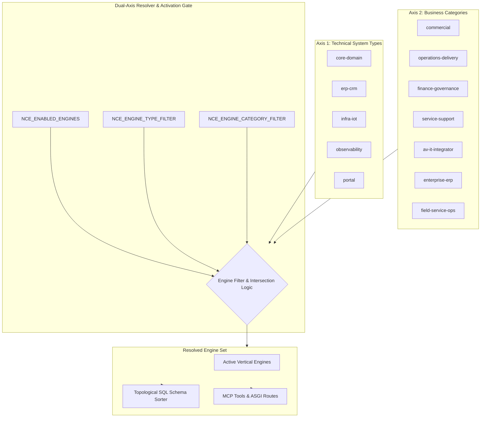
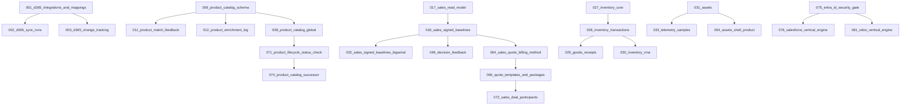
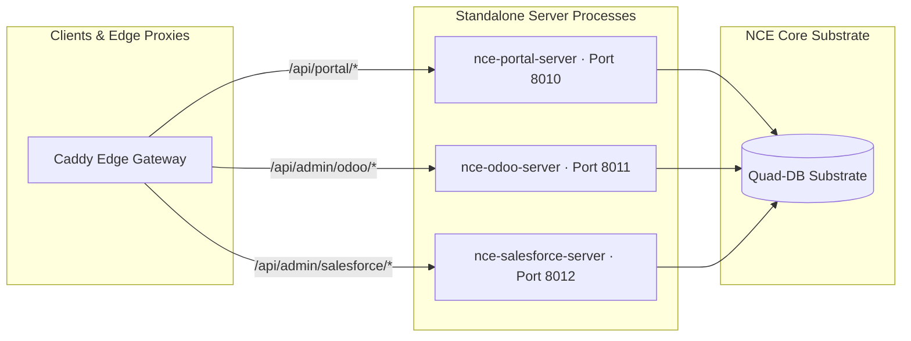

# Dual-Axis Modular Architecture & Engine Resolver

> Architectural specification for Dual-Axis Engine Resolution, Topological SQL Schema Dependency Management, and NCE Core `@v3.4.2` Plugin Contracts in `nce-vertical-engines`.

---

## 1. Executive Overview & Design Motivation

`nce-vertical-engines` provides 22 specialized business engines, ERP/CRM bridges, and infrastructure adapters built upon the **Neuro-Cognitive Engine (NCE)** substrate. Historically, vertical plugins were registered as either an all-or-nothing monolithic package or via individual manual imports. 

As enterprise deployment environments diversify—ranging from lightweight IoT edge appliances and field-technician mobile sync gateways to heavy multi-tenant ERP/CRM cloud nodes—deployments require **fine-grained, orthogonal selection of vertical capabilities**.

The **Dual-Axis Architecture** decouples vertical capabilities along two orthogonal dimensions:
1. **Axis 1: Architectural & Technical System Type (`types`)** — The runtime characteristic and infrastructural role of the engine (`core-domain`, `erp-crm`, `infra-iot`, `observability`, `portal`).
2. **Axis 2: Business & Operational Domain Category (`categories`)** — The business unit, workflow stream, or operational discipline served (`commercial`, `operations-delivery`, `finance-governance`, `service-support`, `av-it-integrator`, `enterprise-erp`, `field-service-ops`).



---

## 2. Orthogonal Dual-Axis Taxonomy

### Axis 1: Technical System Types (`types`)

Axis 1 classifies engines based on their runtime execution topology, dependencies, and external boundary characteristics:

| Type Slug | Name | Description & Boundary Profile | Engines |
|:---|:---|:---|:---|
| `core-domain` | Core Domain Services | Core transactional and computational business engines that operate directly against NCE's Quad-DB substrate and knowledge graph. | `product`, `procurement`, `agreements`, `vendors`, `sales`, `system_design`, `project`, `economy`, `inventory`, `assets`, `support`, `resources`, `field_tech`, `hr`, `marketing`, `business_insights` |
| `erp-crm` | ERP & CRM Connectors | Bidirectional enterprise sync engines connecting external system-of-record databases and APIs into NCE's graph and change-tracking ledgers. | `dynamics365`, `salesforce`, `odoo` |
| `infra-iot` | Infrastructure & IoT | Network topology, hardware discovery, room sensors, and physical infrastructure controllers. | `netbox`, `assets`, `system_design`, `diagnostics` |
| `observability` | Observability & Diagnostics | Telemetry digestion, log anomaly detection, cross-engine risk radar, and executive analytics. | `diagnostics`, `business_insights`, `netbox` |
| `portal` | Customer & Partner Portals | External-facing unprivileged ASGI application shells executing under strict C3 principal confinement. | `customer_portal` |

### Axis 2: Business Domain Categories (`categories`)

Axis 2 classifies engines based on operational responsibility, business units, and organizational workflows:

| Category Slug | Name | Scope & Responsibility | Engines |
|:---|:---|:---|:---|
| `commercial` | Commercial & Commerce | Sales dealrooms, CPQ pricing baselines, customer quote freeze, distributor feeds, agreements, and customer intelligence. | `product`, `procurement`, `agreements`, `vendors`, `sales`, `system_design`, `economy`, `marketing`, `business_insights`, `customer_portal`, `dynamics365`, `salesforce`, `odoo` |
| `operations-delivery` | Operations & Delivery | Stage-gate project execution (G0–G6), multi-warehouse inventory algebra, resource capacity, and ISO competency matrices. | `procurement`, `vendors`, `project`, `inventory`, `assets`, `resources`, `field_tech`, `hr`, `netbox` |
| `finance-governance` | Finance & Governance | NGAAP accounting cascades, PEPPOL e-invoicing, volume rebates (kickbacks), balance verification triggers, and contract audits. | `agreements`, `economy`, `hr`, `business_insights`, `odoo` |
| `service-support` | Service & Support | Multi-tier ticketing, automated SLA countdown clocks, on-call rotation, hardware health profiling, and customer self-service. | `assets`, `support`, `customer_portal`, `diagnostics`, `dynamics365` |
| `av-it-integrator` | AV/IT Integrator Specialist | Specialized AV/IT topology design, Functional Location trees, NetBox DCIM sync, and distributor BOM matching. | `product`, `system_design`, `inventory`, `assets`, `netbox`, `diagnostics` |
| `enterprise-erp` | Enterprise ERP & CRM | Large-scale external enterprise platforms managing master accounts, contacts, field services, and ledger sync. | `dynamics365`, `salesforce`, `odoo` |
| `field-service-ops` | Field Service Operations | Mobile work orders, offline synchronization, technician checklists, and site logistics. | `resources`, `field_tech` |

---

## 3. The 22-Engine Catalog & Metadata Matrix

Every engine specifies its dual-axis classification, optional Python SDK dependencies, and required SQL schema migrations:

| Engine Slug | Display Name | Type Filter(s) | Business Category Filter(s) | Optional SDK Extras | SQL Schema Prerequisites (`requires_schemas`) |
|:---|:---|:---|:---|:---|:---|
| `product` | Product Catalog | `core-domain` | `commercial`, `av-it-integrator` | `product` | `009_product_catalog_schema`, `011_product_match_feedback`, `012_product_enrichment_log`, `038_product_catalog_global`, `071_product_lifecycle_status_check`, `074_product_catalog_successor` |
| `procurement` | Procurement & TCO | `core-domain` | `commercial`, `operations-delivery` | `procurement` | `013_procurement_bid_prices`, `014_procurement_source_id`, `047_procurement_po_lines`, `065_procurement_deal_registrations` |
| `agreements` | Agreements & Rebates | `core-domain` | `commercial`, `finance-governance` | `agreements` | `022_agreement_review`, `023_agreements_source_id`, `061_agreement_parties_and_resources` |
| `vendors` | Vendors & Contractors | `core-domain` | `commercial`, `operations-delivery` | `vendors` | `019_vendors_source_id`, `020_vendor_scorecards`, `021_contractor_profiles` |
| `sales` | Sales & Dealroom | `core-domain` | `commercial` | `sales` | `017_sales_read_model`, `018_sales_signed_baselines`, `032_sales_signed_baselines_bigserial`, `055_sales_resource_tables`, `062_sales_contacts`, `064_sales_quote_billing_method`, `066_quote_templates_and_packages`, `072_sales_deal_participants` |
| `system_design` | System Design & FL | `core-domain`, `infra-iot` | `commercial`, `av-it-integrator` | `system_design` | `015_system_design_source_id`, `016_system_design_device_capabilities`, `034_bom_line_content`, `035_system_design_geometry`, `036_system_design_node_state`, `037_bom_line_priced`, `049_system_design_sidetable_fk_cascade`, `069_system_design_design_requests` |
| `project` | Project Execution | `core-domain` | `operations-delivery` | `project` | `018_sales_signed_baselines`, `048_decision_feedback` |
| `economy` | Economy & Accounting | `core-domain` | `finance-governance`, `commercial` | `economy` | `024_economy_bom_actual_cost`, `025_economy_postings`, `026_economy_contracts`, `059_pricing_fx_rates`, `067_billing_runs`, `068_billing_candidates`, `070_customer_invoices` |
| `inventory` | Warehouse & Inventory | `core-domain` | `operations-delivery`, `av-it-integrator` | `inventory` | `027_inventory_core`, `028_inventory_transactions`, `029_goods_receipts`, `030_inventory_rma` |
| `assets` | Asset Lifecycle & Telemetry | `core-domain`, `infra-iot` | `operations-delivery`, `service-support`, `av-it-integrator` | `assets` | `031_assets`, `033_telemetry_samples`, `054_assets_shell_product` |
| `support` | Support & SLA Clocks | `core-domain` | `service-support` | `support` | `039_support_service_tickets`, `058_support_ticket_actions`, `073_support_ticket_actions_append_only` |
| `resources` | Staff & Capacity Allocator | `core-domain` | `operations-delivery`, `field-service-ops` | `resources` | `043_resources_registry`, `044_allocations_btree_gist` |
| `field_tech` | Field Tech Work Orders | `core-domain` | `operations-delivery`, `field-service-ops` | `field_tech` | `040_field_tech_work_orders` |
| `hr` | HR & Skills Matrix | `core-domain` | `operations-delivery`, `finance-governance` | `hr` | `041_hr_engine` |
| `marketing` | Marketing & Case Studies | `core-domain` | `commercial` | `marketing` | `042_marketing_engine` |
| `business_insights`| Business Insights | `observability`, `core-domain`| `commercial`, `finance-governance` | `business_insights` | `045_business_insights_engine` |
| `customer_portal` | Customer Portal | `portal` | `service-support`, `commercial` | `portal` | `046_customer_portal_engine` |
| `netbox` | NetBox DCIM / IPAM | `infra-iot`, `observability` | `av-it-integrator`, `operations-delivery` | `netbox` | `001_d365_integrations_and_mappings` *(shared mapping table bundled in base wheel)* |
| `dynamics365` | Dynamics 365 Sync | `erp-crm` | `enterprise-erp`, `commercial`, `service-support` | `dynamics365` | `001_d365_integrations_and_mappings`, `002_d365_sync_runs`, `003_d365_change_tracking` |
| `diagnostics` | Diagnostics Profiler | `observability`, `infra-iot` | `service-support`, `av-it-integrator` | `diagnostics` | `004_diagnostics` |
| `odoo` | Odoo ERP Connector | `erp-crm` | `enterprise-erp`, `commercial`, `finance-governance` | `odoo`, `entra_id` | `075_entra_id_security_gate`, `081_odoo_vertical_engine` |
| `salesforce` | Salesforce CRM | `erp-crm` | `commercial`, `enterprise-erp` | `salesforce`, `entra_id` | `075_entra_id_security_gate`, `076_salesforce_vertical_engine` |

---

## 4. Dual-Axis Resolution Algorithm

The Dual-Axis Engine Resolver resolves the active engine set $E_{\text{active}}$ at bootstrap time according to the environment configuration:

### Resolution Formalism

Let $\mathcal{U}$ be the universe of all 22 vertical engines.
Let $T(e) \subseteq \text{Types}$ be the set of types associated with engine $e \in \mathcal{U}$.
Let $C(e) \subseteq \text{Categories}$ be the set of categories associated with engine $e \in \mathcal{U}$.

1. **Explicit Engine Filter ($S_{\text{explicit}}$):**
   - Configured via `NCE_ENABLED_ENGINES`.
   - If `NCE_ENABLED_ENGINES="all"` or unset, $S_{\text{explicit}} = \mathcal{U}$.
   - If `NCE_ENABLED_ENGINES` contains compound syntax `type:<T>+category:<C>`, it evaluates the intersection directly.
   - Otherwise, $S_{\text{explicit}} = \{e \in \mathcal{U} \mid e \in \text{split}(\text{NCE\_ENABLED\_ENGINES})\}$.

2. **Axis 1 Type Filter ($S_{\text{type}}$):**
   - Configured via `NCE_ENGINE_TYPE_FILTER`.
   - If unset or empty, $S_{\text{type}} = \mathcal{U}$.
   - If set to comma-separated types $\{t_1, t_2, \dots\}$, $S_{\text{type}} = \{e \in \mathcal{U} \mid T(e) \cap \{t_1, t_2, \dots\} \neq \emptyset\}$.

3. **Axis 2 Category Filter ($S_{\text{category}}$):**
   - Configured via `NCE_ENGINE_CATEGORY_FILTER`.
   - If unset or empty, $S_{\text{category}} = \mathcal{U}$.
   - If set to comma-separated categories $\{c_1, c_2, \dots\}$, $S_{\text{category}} = \{e \in \mathcal{U} \mid C(e) \cap \{c_1, c_2, \dots\} \neq \emptyset\}$.

4. **Resolved Active Engine Set ($E_{\text{active}}$):**
   $$E_{\text{active}} = S_{\text{explicit}} \cap S_{\text{type}} \cap S_{\text{category}}$$

If $E_{\text{active}} = \emptyset$, the resolver fails closed, preventing partial or ambiguous boots.

---

## 5. Topological SQL Schema Dependency Graph

Vertical engines introduce relational schemas with foreign key references, audit triggers, and tenant Row-Level Security (RLS) constraints. The engine loader ensures schema integrity by resolving a directed acyclic graph (DAG) of migration prerequisites before mounting runtime routes or MCP tools.

### Dependency DAG Flow



### Topological Execution Rules
1. **Idempotence**: Every SQL migration enforces `CREATE TABLE IF NOT EXISTS`, conditional policy definitions, and idempotent index declarations.
2. **Prerequisite Validation**: When engine $e$ is resolved in $E_{\text{active}}$, its `requires_schemas` prerequisites are verified against the database catalog. If a prerequisite schema is missing, the migration runner applies it in strict topological order.
3. **Tenant Isolation Verification**: Immediately following schema creation, RLS is forced:
   ```sql
   ALTER TABLE <table_name> ENABLE ROW LEVEL SECURITY;
   ALTER TABLE <table_name> FORCE ROW LEVEL SECURITY;
   ```

---

## 6. NCE Core `@v3.4.2` Plugin Integration Contract

`nce-vertical-engines` implements the standard NCE Core v3.4 plugin protocol via the Python entry-point mechanism:

```toml
[project.entry-points."nce.plugins"]
nce_verticals = "nce_verticals.plugin:VerticalEnginesPlugin"
```

### Protocol Signature
Each engine conforms to the `NCEPlugin` protocol:
```python
class NCEPlugin(Protocol):
    plugin_id: str
    requires_schemas: list[str]

    def register_tools(self, registry: dict[str, ToolSpec]) -> None:
        """Register MCP tool definitions."""
        ...

    def register_routes(self, app: Any) -> None:
        """Register Starlette / FastAPI routes."""
        ...

    def register_workers(self, worker_registry: Any) -> None:
        """Register background RQ / Celery queue handlers."""
        ...

    def register_cognitive_hooks(self, cognitive_engine: Any) -> None:
        """Register episodic memory, Ebbinghaus decay, and ATMS listeners."""
        ...

    def get_migration_dir(self) -> Path | None:
        """Return directory containing schema SQL files."""
        ...
```

When `VerticalEnginesPlugin` boots within NCE Core's orchestrator (`NCEEngine`), it evaluates `E_active` and invokes registration hooks **only for the resolved engines**, preventing tool and route bloat in scoped environments.

---

## 7. Standalone Server Architecture & Process Isolation

To support micro-deployments, three engines ship with dedicated, standalone ASGI server entrypoints:



1. **`nce-portal-server` (Port 8010)**:
   - Module: `nce_verticals.servers.portal:app`
   - Purpose: Zero-trust customer self-service app shell.
   - Isolation: Operates with 0 admin credentials (`NCE_MASTER_KEY=""`, `NCE_ADMIN_API_KEY=""`), non-root UID `10001:10001`, and C3 customer-scoped RLS.
2. **`nce-odoo-server` (Port 8011)**:
   - Module: `nce_verticals.servers.odoo:app`
   - Purpose: Odoo XML-RPC/JSON-RPC synchronization and cross-engine LLM crosstalk gated by Microsoft Entra ID authentication.
3. **`nce-salesforce-server` (Port 8012)**:
   - Module: `nce_verticals.servers.salesforce:app`
   - Purpose: Salesforce REST/Bulk 2.0 sync gated by Microsoft Entra ID authentication.

---

## 8. Security & Workplace Telemetry Governance

### Microsoft Entra ID OIDC / JWKS Verification (`nce_verticals.security.entra_id`)
Standalone server endpoints and MCP admin tools verify enterprise Microsoft identity:
- **Strict Cryptographic JWT Validation**: Keys fetched dynamically from `https://login.microsoftonline.com/{tenant_id}/discovery/v2.0/keys` with bounded TTL caching (default 3600s).
- **Algorithm Allowlist**: Restricted strictly to `RS256` and `ES256`.
- **Claim Checking**: Enforces `iss`, `aud`, `exp`, `nbf`, `tid`, and `oid`.
- **Transitive Group Membership**: Checks Microsoft Graph Security Group IDs and Enterprise Application App Roles before granting administrative access.

### Workplace Telemetry Opt-In Gate (`NCE_ENABLE_WORKPLACE_TELEMETRY=false`)
In compliance with European workplace privacy standards (GDPR / Norwegian Working Environment Act / *Arbeidsmiljøloven* § 13), **longitudinal operator stress tracking is strictly disabled by default**:
- `NCE_ENABLE_WORKPLACE_TELEMETRY=false` (Default):
  - **NetBox Contacts**: `fetch_stress_records_for_operator` returns `[]` without hitting the database. `evaluate_contact_stress_report` returns status `telemetry_disabled` with zeroed frustration metrics. On-call routing maintains all active contacts at weight `1.0` and status `active`.
  - **Dynamics 365 Ingestion**: `_compute_empathic_tensor` yields neutral baseline `[5.0, 0.0, 5.0, 0.0, 0.0, 0.0]`. `_insert_cognitive_ledger` is a no-op, skipping insertion into `v3_cognitive_ledger`.
  - **Dynamics 365 MCP Handlers**: `handle_d365_case_stress_report` immediately returns `telemetry_disabled` without reading the cognitive ledger.
- `NCE_ENABLE_WORKPLACE_TELEMETRY=true` (Explicit Opt-In):
  - Operator frustration scores (> 7.0) trigger cognitive load alerts, on-call weight rebalancing, and burnout standby routing.
